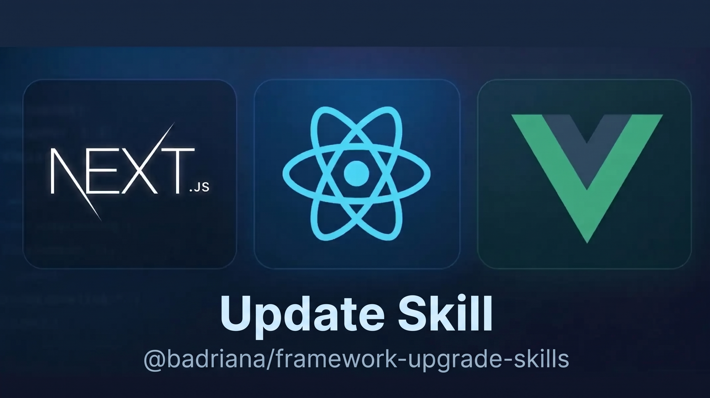

<p align="center">
  
</p>

# Framework Upgrade Skills Suite

Suite keahlian AI (skills) untuk memigrasikan dan meng-upgrade versi framework frontend (**React**, **Next.js**, dan **Vue.js**) secara otomatis, aman, dan berlandaskan **dokumentasi resmi**, tanpa halusinasi perubahan API.

---

## 🏗️ Arsitektur Skill

Sistem ini dirancang menggunakan pendekatan **spesialis modular**, dipimpin oleh sebuah orchestrator:

```
skills/
├── framework-upgrade-orchestrator/   # [Pintu Masuk] Mendeteksi framework & mengatur alur delegasi
│   ├── SKILL.md
│   └── references/
│       ├── triage-workflow.md        # Deteksi monorepo, framework & package manager
│       └── execution-checklist.md    # Quality gates & verifikasi 4 tahap
│
├── react-upgrade/                    # [Spesialis React] React 17 -> 18 -> 19
│   ├── SKILL.md
│   └── references/
│       ├── react19-breaking-changes.md # ref as prop, useActionState, context, defaultProps removal
│       ├── react18-breaking-changes.md # createRoot, automatic batching
│       ├── codemod-guide.md          # npx codemod@latest react/19/...
│       └── compatibility-matrix.md   # Node.js, TypeScript, UI libs
│
├── nextjs-upgrade/                   # [Spesialis Next.js] Next.js 13 -> 14 -> 15
│   ├── SKILL.md
│   └── references/
│       ├── next15-breaking-changes.md # async request APIs (cookies, headers, params), caching shift
│       ├── next14-breaking-changes.md # server actions, metadata
│       ├── codemod-guide.md          # @next/codemod upgrade
│       ├── pages-vs-app-router.md    # Aturan ketat: Jangan ubah Pages Router tanpa izin!
│       └── compatibility-matrix.md   # Next.js vs Node.js vs React 19
│
├── vue-upgrade/                      # [Spesialis Vue.js] Vue 2 -> Vue 3
│   ├── SKILL.md
│   └── references/
│       ├── vue3-breaking-changes.md  # createApp, v-model, listeners/attrs, lifecycle, Vue.set
│       ├── vue-router-and-state.md   # Vue Router 3->4, Vuex->Pinia
│       ├── migration-build-guide.md  # Strategi bertahap dengan @vue/compat
│       └── compatibility-matrix.md   # Node.js, Vite, TypeScript
│
└── framework-upgrade/                # [Skill Fondasi] Skill all-in-one / general fallback
    ├── SKILL.md
    └── references/
        └── general-upgrade-rules.md  # Prinsip anti-halusinasi & resolusi dependensi
```

---

## 🛡️ Prinsip Utama (Anti-Halusinasi)

1. **Sumber Kebenaran Adalah Dokumentasi Resmi**: AI tidak boleh mengarang API baru atau parameter fungsi berdasarkan ingatan model semata. AI harus memeriksa dokumentasi resmi, codemods resmi, dan file referensi lokal yang tersedia.
2. **Tidak Mengubah Arsitektur Tanpa Instruksi**:
   - Next.js: Project **Pages Router** **TIDAK BOLEH** langsung dirombak menjadi **App Router** kecuali ada permintaan eksplisit dari pengguna.
   - Vue: Komponen **Options API** **TIDAK BOLEH** dirombak paksa menjadi `<script setup>` hanya karena gaya baru.
3. **Upgrade Bertahap (Stepwise Major Version)**: Hindari melompati multi-versi secara drastis tanpa codemod resmi atau langkah persiapan (misal: Vue 2.6 -> 2.7 -> 3.x).
4. **Verifikasi Otomatis Nyata**: Menyatakan migrasi berhasil hanya jika perintah verifikasi (`tsc`, `lint`, `build`, `test`) benar-benar dieksekusi dan lolos.

---

## 🔄 4 Tahap Alur Kerja

```
1. Analisis Project  ──>  2. Pelajari Dokumen  ──>  3. Rencana Migrasi  ──>  4. Upgrade & Verifikasi
   - package.json          - Breaking changes        - Daftar file kena      - Package install
   - Lockfile              - Deprecated API          - Codemod runner        - Run codemods
   - Router model          - Compatibility check     - Risk assessment       - Typecheck & test
```

---

## 💻 Cara Install & Digunakan oleh Orang Lain Lewat Terminal

Anda dan pengguna lain dapat menginstall dan menggunakan skill suite ini melalui beberapa cara praktis berikut:

### Metode 1: Lewat NPX / NPM (Paling Direkomendasikan untuk Publik)

Setelah dipublikasikan ke npm registry, siapa pun dapat langsung menginstallnya dengan satu perintah di terminal:

```bash
# Menjalankan installer otomatis (mendeteksi Antigravity / Claude Code)
npx @badriana/framework-upgrade-skills install

# Atau menentukan target spesifik:
npx @badriana/framework-upgrade-skills install --agent antigravity
npx @badriana/framework-upgrade-skills install --agent claude
npx @badriana/framework-upgrade-skills install --agent local # Pasang di project saat ini (.agents/skills)

# Memeriksa framework & versi project sebelum upgrade:
npx @badriana/framework-upgrade-skills inspect
```

---

### Metode 2: One-Liner Script (Tanpa Install NPM)

Pengguna lain cukup menjalankan 1 baris perintah di terminal mereka:

**Di Windows (PowerShell):**
```powershell
irm https://raw.githubusercontent.com/badriana400952/skill-update-versi/main/install.ps1 | iex
```

**Di Linux / macOS (Bash / Zsh):**
```bash
curl -fsSL https://raw.githubusercontent.com/badriana400952/skill-update-versi/main/install.sh | bash
```

---

### Metode 3: Git Clone & Local Run

Jika pengguna meng-clone repository ini secara manual:

```bash
git clone https://github.com/badriana400952/skill-update-versi.git
cd skill-update-versi

# Install skills ke Antigravity & AI Agent di komputernya:
node bin/cli.js install

# Atau jika di Windows via PowerShell:
.\install.ps1
```

---

## 🤖 Cara Menggunakan Skill di AI Coding Agent

Setelah pengguna menginstall suite ini via terminal (`npx @badriana/framework-upgrade-skills install` atau script lainnya), skill akan otomatis terdaftar di AI agent mereka.

---

### 1. AI Agent Apa Saja yang Didukung?

| AI Agent / Tool | Lokasi Folder Skill | Cara Integrasi |
| :--- | :--- | :--- |
| **Google Antigravity** | `~/.gemini/config/skills/` | Otomatis terdeteksi global |
| **Claude Code (Anthropic)**| `~/.claude/skills/` atau `./.claude/skills/` | Otomatis terdeteksi via `/skill` |
| **Cursor / Windsurf** | `./.agents/skills/` atau `.cursorrules` | Diletakkan di root project target |
| **Open-source Coding Agents**| `./.agents/skills/` | Standar direktori skills agent |

---

### 2. Apakah Menggunakan Slash Command atau Prompt Biasa?

Pengguna bisa menggunakan **salah satu dari 3 cara berikut**, sesuai gaya kerja masing-masing:

#### Opsi A: Prompt Alami / Natural Language (Paling Praktis)
AI Coding Agent memiliki kemampuan *semantic routing*. AI akan secara otomatis memanggil skill yang tepat begitu pengguna menyebutkan kata kunci upgrade framework:
```text
Tolong analisis project ini dan upgrade ke Next.js 15 mengikuti dokumentasi resminya.
```
```text
Migrasikan aplikasi React 18 ini ke React 19, cari breaking changes dan perbaiki.
```

#### Opsi B: Menggunakan Slash Command (`/skill`)
Di **Claude Code** atau antarmuka agent yang mendukung slash command:
```text
/skill framework-upgrade-orchestrator
```
Atau memanggil spesialis langsung:
```text
/skill react-upgrade
/skill nextjs-upgrade
/skill vue-upgrade
```

#### Opsi C: Explicit Skill Mention
Menyebutkan nama skill secara spesifik di prompt agar AI langsung fokus ke instruksi skill tersebut:
```text
Gunakan skill "framework-upgrade-orchestrator" untuk memeriksa versi dan merencanakan upgrade project ini.
```
```text
Gunakan skill "nextjs-upgrade". Jangan rombak Pages Router ke App Router, cukup naikkan versi Next.js ke 15.
```

---

### 3. Contoh Skenario & Prompt Nyata

#### Skenario 1: Next.js 14 ke Next.js 15
```text
Saya punya project Next.js 14. Tolong gunakan skill nextjs-upgrade untuk:
1. Memperbarui dependensi Next.js dan React 19
2. Menjalankan codemod resmi untuk async request APIs (cookies, headers, params)
3. Memeriksa konfigurasi caching fetch
4. Menjalankan tsc dan npm run build untuk memverifikasi hasilnya
```

#### Skenario 2: React 18 ke React 19
```text
Gunakan skill react-upgrade untuk memigrasikan project ini ke React 19:
1. Jalankan codemod resmi react/19
2. Cari dan ubah defaultProps pada function component ke ES6 default parameter
3. Perbaiki ref callback dan forwardRef yang deprecated
4. Jalankan typecheck untuk memastikan tidak ada error tipe TypeScript
```

#### Skenario 3: Vue 2 ke Vue 3
```text
Gunakan skill vue-upgrade untuk meng-upgrade aplikasi Vue 2 ini:
1. Buat rencana migrasi bertahap menggunakan @vue/compat
2. Jangan ubah Options API menjadi <script setup> kecuali ada error yang mengharuskan
3. Perbarui Vue Router ke v4 dan perbaiki sintaks event bus ($on/$off)
```

---

### 4. Apa yang Terjadi di Balik Layar Saat Skill Berjalan?

Ketika pengguna memicu skill ini, AI agent **tidak akan langsung mengubah kode secara membabi-buta**:
1. **Fase 1 (Inspeksi)**: AI membaca `package.json`, lockfile, dan file konfigurasi (`next.config.*`, `vite.config.*`, `tsconfig.json`).
2. **Fase 2 (Dokumentasi Resmi)**: AI membuka referensi lokal (`breaking-changes.md`, `compatibility-matrix.md`) atau mencari panduan resmi versi target.
3. **Fase 3 (Rencana Migrasi)**: AI menyusun daftar file yang terkena dampak, dependensi yang bentrok, dan codemod yang bisa dijalankan.
4. **Fase 4 (Eksekusi Aman)**: AI menjalankan codemod resmi, melakukan perbaikan kode terkecil yang aman, lalu mengeksekusi `install`, `typecheck`, dan `build`.
5. **Fase 5 (Laporan Akhir)**: AI melaporkan file yang diubah, status build, dan catatan jika ada dependensi pihak ketiga yang perlu perhatian manual.


---

## 🧰 Alat Bantu Otomatis

Tersedia skrip pemeriksa instan di `scripts/inspect-project.mjs`:
```bash
node scripts/inspect-project.mjs /path/ke/project-target
```
Output berupa ringkasan JSON yang berisi versi saat ini, arsitektur routing (Pages/App), package manager, dan rekomendasi skill yang harus dipanggil.
